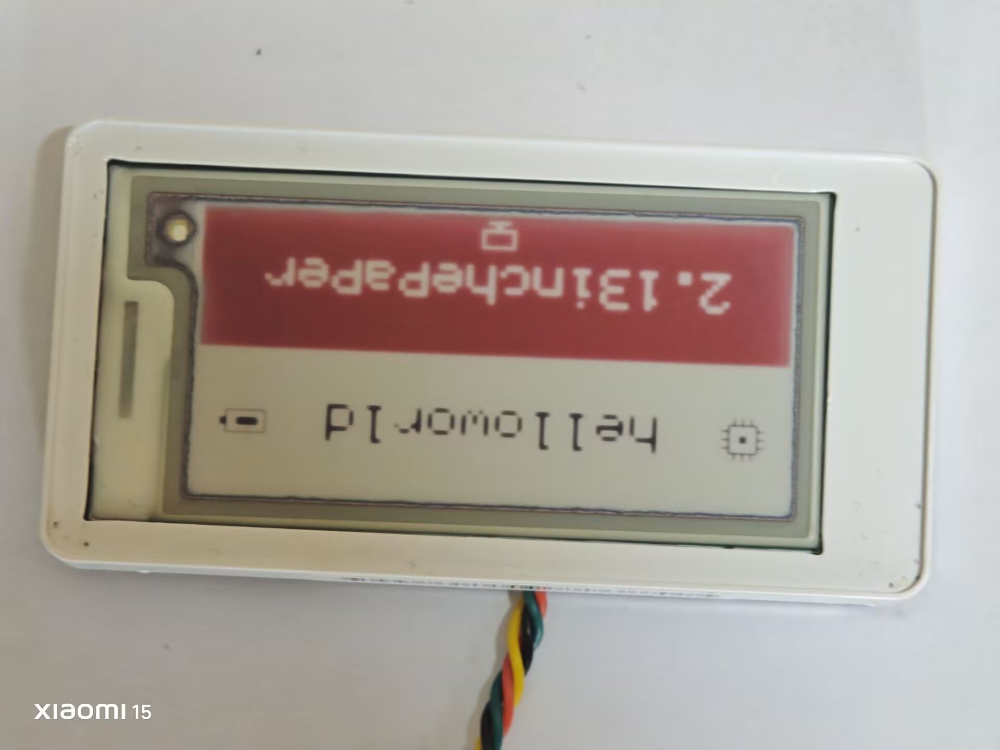

# 硬件探索记录

这块板来自 LG Innotek ESL TAG2.13B（REBE-TZ21B），目标是把原厂电子价签拆开、读出资源，再用 Keil5 固件和手机 NFC 应用复现可控显示。这里放面向读者的硬件介绍；逐项证据和原始文件仍见 [`docs/HARDWARE.md`](docs/HARDWARE.md) 与 [`docs/PHOTO_INDEX.md`](docs/PHOTO_INDEX.md)。

## 看到的硬件

主控是 ATSAMR21G18A，拥有 256 KiB Flash 和 32 KiB SRAM；屏幕模组标记为 WF0213T50CZ16E41e，原生 104×212，横向使用时为 212×104 黑白红。板上同时有 NFC 印刷线圈和 2.4 GHz 印刷天线。

NFC 的 MCU 侧连接为 PA16/PA17（SERCOM1 I²C），手机读到的 UID 是 `04 16 9A 6A 1E 44 80`。精确 NFC 芯片料号仍未确认；后续协议使用未锁定的 SRAM 邮箱分块传输。

## 摸索过程

1. 先用 ST-Link 读 Flash、SRAM、用户行和辅助区，保留原厂 Flash/EEPROM 备份；两次完整 Flash 读取一致。
2. 观察原厂启动序列，确认屏幕坐标、三色双平面、SPI 引脚、BUSY 和约 15 秒完整刷新。
3. 处理 ST-Link 接入后偶发不刷新的复位状态，清除 `CRSTEXT` 后原厂固件恢复运行。
4. 用白屏、红屏、黑边和缺角对照刷新，确认外圈混色区域与可控细边行为不同。
5. 在 NFC 邮箱迁移到 RF `90h..9Fh` 后，手机可以识别固件、分块写入整图；用户确认 v0.1.2 上传成功。
6. Android v0.1.4 汇总编辑器、固定预览、旋转、裁切、亮度/对比度和抖动；后续再把 NFC 上传与板端协议合并到同一仓库。

## 实物记录

第一版画面方向倒置，之后修正为横向正常方向。用户仍观察到黑字折角偏淡、红底白字发泛；清晰度不能仅凭照片归因于老化，供电负载、温度、波形和屏幕确切 IC 仍待仪器验证。

白屏刷新后外圈黑边基本不变；调整屏幕边框设置时缺角出现过一条细黑边，恢复设置后消失。当前固件保留白色边框配置，不把外圈混色当作可刷除区域。

正面端子座用于 SWD 下载和调试；另有一组背面测试点在装配时被屏幕覆盖。常用四线为 SWDIO、SWCLK、GND 和稳定 3.3 V。

## 目前仍未知

- 墨水屏驱动 IC 的精确型号、OTP/LUT 和升压波形。
- 外圈混色的具体材料或边缘粒子状态。
- NFC 芯片精确型号、VCC 跌落后的镜像恢复和多机兼容性。
- 原厂 2.4 GHz 空中协议、配对与加密。
- UART、外置 SPI NOR 和电池 ADC 的完整电气验证。

不要把照片中的线索当成测量结论；所有已验证和未验证边界都在硬件文档中保留。
