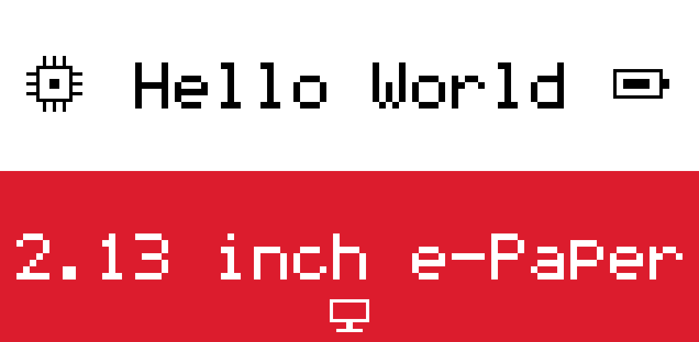

# SAMR21 2.13 inch e-Paper

LG Innotek ESL TAG2.13B 的硬件资料、原厂固件备份恢复记录和 Keil5 C/ASM 显示工程。

本仓库的默认示例为横向 **212×104 黑白红**：上半白底黑字 Hello World，下半红底白字 2.13 inch e-Paper，带像素图标；上电刷新一次。方向已由用户确认。黑字折角偏淡、红底白字发泛仍未解决，尚不能认定为屏幕老化。

## 2026-10-27 局刷时钟

新增 [独立分钟时钟工程](firmware/SAMR21_213_Clock/README.md)：24 小时制大字、只更新变化数字、每小时原厂全刷。单数字局刷已获用户确认；仍有暂时淡粉色残影，字体外观和长期效果继续改进。详见 [实验记录](docs/PARTIAL_CLOCK_20261027.md)。

## 仓库内容

| 目的 | 入口 |
|---|---|
| 看主板、屏幕、引脚和原始照片 | 本仓库：[硬件介绍](docs/HARDWARE.md)、[24 项原始资料索引](docs/PHOTO_INDEX.md) |
| 编译显示示例、做白屏/红屏/边框实验、恢复原厂 | 本仓库：[快速开始](docs/GETTING_STARTED.md)、[Keil 工程](firmware/SAMR21_EPD_Keil/README.md) |
| 手机选图、调整图片并用 NFC 上传 | [`nfc/`](nfc/)，Android v0.1.5 配板端 v0.1.2；发布包见 [Releases](https://github.com/NannXi/SAMR21-213-EPaper/releases) |
| 了解哪些做过、哪些还未知 | [当前状态与证据](docs/STATUS.md)、[显示质量记录](docs/DISPLAY_QUALITY.md) |

NFC 工程已并入本仓库，Keil 显示工程、NFC 固件、Android 应用和全部硬件资料在同一份版本树中。原 `SAMR21-213-NFC` 仓库暂时保留，待本仓库验收后再决定是否删除。

## 硬件概况

| 项目 | 已确认信息 |
|---|---|
| 主板 | LG Innotek ESL TAG2.13B Rev0.1 / REBE-TZ21B |
| 主控 | ATSAMR21G18A，Cortex-M0+，256 KiB Flash、32 KiB SRAM |
| 屏幕 | WF0213T50CZ16E41e，原生 104×212，横向 212×104，黑白红；驱动 IC 料号未知 |
| 调试 | ST-Link SWD，PA31=SWDIO、PA30=SWCLK、GND、已验证的 3.3 V 供电 |
| 屏幕接口 | PA23 CS、PA24 SDIO、PA25 SCLK、PA27 BUSY、PA28 电源使能、PB22 D/C、PB23 RESET |
| NFC | PA16 SDA、PA17 SCL，I²C 地址 0x55，NTAG I²C 兼容行为；精确型号未知 |
| 无线 | 片内 IEEE 802.15.4 射频及板载天线已定位，原厂空中协议未解析 |

端口表、芯片封装脚号、屏幕 FPC 针序是不同概念；完整证据和未知项见[硬件文档](docs/HARDWARE.md)。

## 从哪里开始

1. 先看[接线、编译、烧录与恢复](docs/GETTING_STARTED.md)，核对板卡型号。
2. 用 Keil5 ARM Compiler 5 打开 `firmware/SAMR21_EPD_Keil/SAMR21_EPD.uvprojx`。
3. 编译后通过工程内 `flash.ps1` 下载。电脑端 Python 只控制 ST-Link，MCU 运行 C/ASM。
4. 等刷新完成后观察实物。Keil 内置 FLM 下载与在线调试尚未配置。

已提供预编译 `Objects/epd_white.axf/.bin/.hex`，名称继承最初白屏测试，实际内容为当前示例。使用探针前可通过 `EPD_PROBE_SERIAL` 指定自己的 ST-Link。

## 资料导航

| 路径 | 内容 |
|---|---|
| [HARDWARE.md](HARDWARE.md) | 面向读者的硬件介绍、照片和摸索过程 |
| [docs/HARDWARE.md](docs/HARDWARE.md) | 供电、主控、SWD、屏幕、NFC、无线、UART、ADC、可选存储及接口边界 |
| [docs/PHOTO_INDEX.md](docs/PHOTO_INDEX.md) | 22 张照片、原始说明与离线 DFP 包，共 24 项 |
| [docs/ORIGINAL_FIRMWARE.md](docs/ORIGINAL_FIRMWARE.md) | 原厂内存布局、函数入口、图像格式、备份和恢复证据 |
| [docs/STATUS.md](docs/STATUS.md) | 当前能力、证据等级、已知限制与后续工作 |
| [docs/investigation_history](docs/investigation_history) | 早期原厂探测、快照、反汇编与编程记录 |
| [tools/investigation_history](tools/investigation_history) | 早期脚本，保留历史路径，日常使用请走工程内工具 |
| [repository_manifest.json](repository_manifest.json) | 受版本管理文件的字节数与 SHA-256 清单 |
| [CONTRIBUTING.md](CONTRIBUTING.md) | 修改、校验和反馈要求 |
| [NOTICE.md](NOTICE.md) | 原创、第三方与原厂材料的权利边界 |

运行 `python tools/check_repository.py` 可离线检查资料链接、JSON、Keil 输入和哈希清单。GitHub Actions 执行同一检查；不连接实物，不把自动检查等同于硬件验证。

整理日期：2026-10-23。硬件实验记录主要来自 2026-10-21；NFC 应用和板端协议已并入 `nfc/`。
