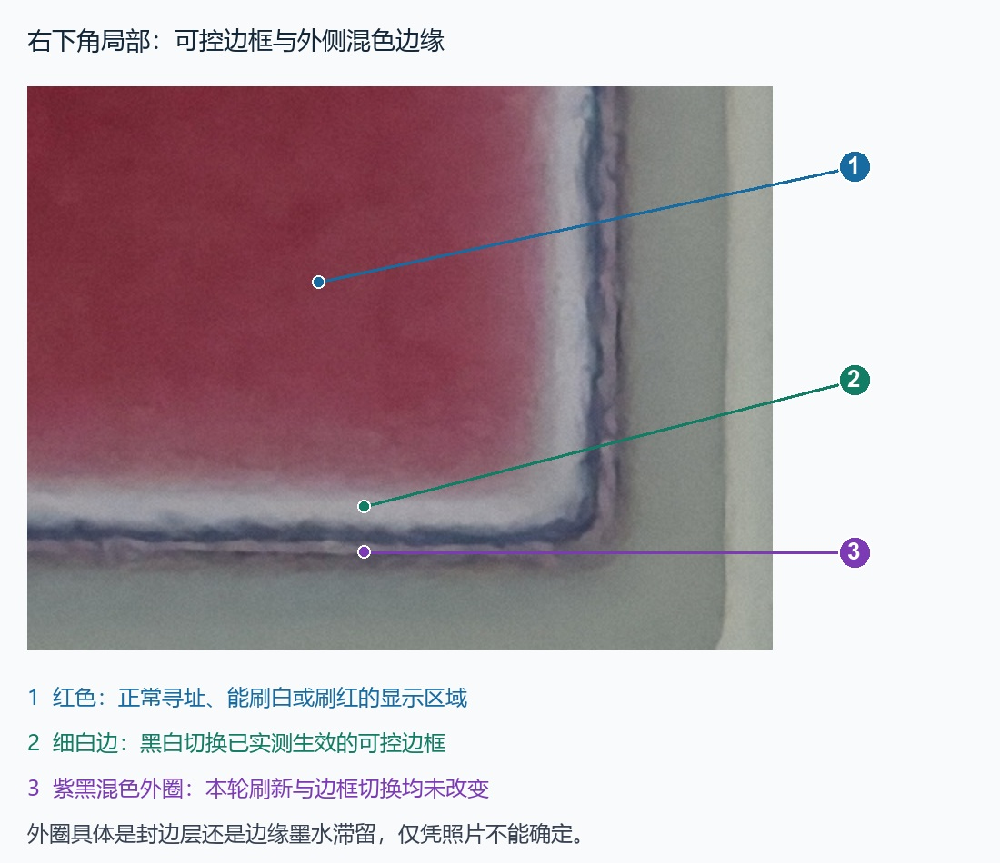

# 硬件资源完整介绍

更新日期：2026-10-22。对象是本仓库照片中的一块 LG Innotek 2.13 寸黑白红电子价签；不同批次不能直接视为相同硬件。

本页汇总用户最初整理的材料、原厂程序分析、SWD 实测和后续自制固件验证。表中的“用户提供”保留原始观察，“程序配置”不等于已测量外部信号，“推导”也不等于仪器测量。

相关入口：[全部原始资料与照片](PHOTO_INDEX.md) · [原厂固件与内存布局](ORIGINAL_FIRMWARE.md) · [显示清晰度记录](DISPLAY_QUALITY.md) · [Keil 工程](../firmware/SAMR21_EPD_Keil/README.md)。

## 1. 整机、板卡与拆解状态

| 项目 | 资料与结论 |
|---|---|
| 产品 | LG Innotek Electronic Shelf Label，外壳型号 REBE-TZ21B |
| PCB 丝印 | ESL TAG 2.13B，Rev0.1，2016-01-20 |
| 主控 | Microchip / Atmel ATSAMR21G18A，Cortex-M0+ |
| 显示 | 威峰科技 / WUXI VISION PEAK，WF0213T50CZ16E41e，2.13 寸黑白红 |
| 天线 | 板载 2.4 GHz 印刷天线及匹配网络，另有 NFC 印刷线圈 |
| 原供电 | 用户记录为两节 CR2430 并联，约 3 V；电池已拆下，电池座保留 |
| 当前供电和调试 | ST-Link 的 3.3 V、GND、SWDIO、SWCLK 四线连接，已实机读写和启动 |
| 测试点损伤 | 用户报告主控旁屏幕 SPI 测试焊盘脱落，内部走线仍通；后续屏幕刷新正常，证明所用显示链路可工作 |
| SWD 测试点 | 用户已测通并焊好正面端子座；背面另有一组点，正常装配时被屏幕覆盖 |

主板、裸屏、标签、掉焊盘和接线近照均完整收录在[资料索引](PHOTO_INDEX.md)。脱落测试焊盘的逐条电气连通性没有在本轮用万用表重测；不能由屏幕能刷新推定所有测试点都完好。

## 2. 主控与片内资源

| 资源 | 结果 | 依据与范围 |
|---|---|---|
| 处理器 | ARM Cortex-M0+ | 芯片照片、DFP、CPUID `0x410CC601` |
| 器件识别 | DSU.DID=`0x10010319` | SWD 实读 |
| 内部 Flash | 256 KiB，`0x00000000..0x0003FFFF` | 完整双读、NVM PARAM=`0x00031000` |
| SRAM | 32 KiB，`0x20000000..0x20007FFF` | 器件描述、完整快照；未做破坏性 RAM 压力测试 |
| Flash 几何 | 页 64 字节；擦除行 256 字节，共 1024 行 | 器件包和实际编程、回读 |
| 保护状态 | PROT=0、LOCK=`0xFFFF`、BOOTPROT=7（保护大小 0） | 原板实读；没有通过解锁改变这些位 |
| 原厂程序系统时钟 | 从寄存器推导 48 MHz | DFLL48M、GCLK0 与 CPU 分频配置；没有测频 |
| 当前自制固件时钟 | OSC8M，8 MHz | 当前 C 工程系统初始化 |
| 硬件断点 | 观察到 4 个比较器 | 调试实测，原厂分析使用硬件断点 |
| 看门狗 | 原厂观察时 WDT.CTRL=`0x00` | 该次快照禁用，不代表所有固件状态都禁用 |

DFP 列出的其他模块包括 AC、ADC、DMAC、DSU、EIC、EVSYS、GCLK、SBMATRIX、MTB、NVMCTRL、FUSES、PAC0/1/2、PM、PORT、PTC、RFCTRL、RTC、SERCOM0..5、SYSCTRL、TC3/4/5、TCC0/1/2、USB、WDT，以及 NVIC、SysTick、SystemControl。它们是芯片资源清单，不能等同于 PCB 已引出或空闲可用的接口。

### 原厂 SERCOM 分工

| 实例 | 原厂用途 | 验证程度 |
|---|---|---|
| SERCOM0 | 可选 SPI NOR 存储驱动 | 代码已定位，外置芯片是否焊接未确认 |
| SERCOM1 | NFC I²C | 地址 0x55 的块 0 读取成功 |
| SERCOM2 | UART | 初始化代码为 115200，尚未接 USB-TTL 验证 |
| SERCOM3 | 墨水屏 SPI | 运行配置、命令捕获和屏幕刷新均已验证 |
| SERCOM4 | 片内射频 SPI | 内部接线和活动寄存器已确认，空中协议未解析 |
| SERCOM5 | 未定位明确用途 | 不能直接认定空闲或已引出 |

## 3. 供电、升压与板上现象

原始说明记录：电感附近大电容一端约 3 V、另一端约 −13 V，刷新后电压逐渐回落。这是用户提供的测量现象，本轮没有复测该节点，也没有测升压波形、纹波或刷新峰值电流。

屏幕供电使能为 PA28，高电平开启；当前程序在刷新完成、执行屏幕断电命令后拉低 PA28，并将相关 GPIO 拉低。能保留画面不等于整机已经低功耗：自制程序仍用 SysTick 和轻睡眠保留调试访问，尚未测量静态电流或实现电池续航策略。

ST-Link 报告目标电压约 3.30 V；这不能代替屏幕升压和动态供电测量。原电池输入点 BAT_IN 与板上电源网络的精确关系尚未重新测绘；不要把原来约 3 V 的电池入口当作已验证的 5 V 输入。

## 4. SWD、接线与接调试器不刷新的原因

| 信号 | MCU 端口 | QFN48 脚号 | 使用情况 |
|---|---|---:|---|
| SWCLK | PA30 | 45 | 接 ST-Link SWCLK |
| SWDIO | PA31 | 46 | 接 ST-Link SWDIO |
| GND | 地 | — | 探针与主板共地 |
| 3.3 V | 本次板卡供电 | — | 当前四线连接已实测；端子座物理顺序应按照片辨认 |

QFN48 脚号是主控封装位置，不是端子座脚号，也不是屏幕排线脚号。[正面端子座](../hardware/original_materials/正面烧录点（已焊端子座）.jpg)和[背面烧录点](../hardware/original_materials/背面烧录点（被屏幕盖住）.jpg)照片可用于辨认位置。背面照片还标有 BAT_IN、RESET、GND，本轮日常下载使用已验证的四线 SWD，不需要推定 RESET 测试点已接入下载器。

ST-Link V2 固件版本 V2J37M7；实测 SWD 100 kHz 和 1 MHz 均能读取，后续编程采用 1 MHz。Windows 驱动安装后可用。当前工具使用 pyOCD 的通用 Cortex-M 目标，关闭自动解锁和器件包自动调试序列。

最初“接上四根调试线后原程序不刷新”的一次实测状态是 `State.RESET`、DSU.STATUSA=`0x02`，即 CRSTEXT 复位延长位。依据 Microchip 器件包调试脚本，对 `0x41002101` 写入 **一个字节** `0x02` 清除 W1C 位后，原程序恢复启动并刷新。后续下载使用 DEMCR 复位捕获、SYSRESETREQ、DHCSR 停机与 CRSTEXT 释放流程，已验证不依赖当前应用函数地址即可停在复位入口。

这解释了本次遇到的一个实际原因，不表示所有不刷新故障都由复位延长引起。早期部分睡眠阶段的调试访问出现 AP/DP wait；最终捕获成功，并已清除断点、释放 CPU。Keil 原生 SAMR21 FLM 与 Keil 内部在线调试尚未配置，编译与当前外部下载工具是两条已明确记录的流程。

## 5. 墨水屏模组、总线和引脚

| 项目 | 结果 |
|---|---|
| 标签型号 | WF0213T50CZ16E41e |
| FPC 标记 | WFT0213CZ16 LW |
| 控制器坐标 | 104×212；原厂实际发送 `61 68 00 D4` |
| 横向显示 | 212×104，黑 / 白 / 红 |
| SPI | 原程序 SERCOM3，模式 3；BAUD=0，结合 48 MHz 推导约 24 MHz |
| 当前驱动 | 8 MHz CPU 下 GPIO 软件 SPI，模式 3；没有仪器测量实际 SPI 频率 |
| BUSY | 低电平忙，高电平就绪 |
| 当前完整刷新 | 约 15 秒，程序观察 BUSY 正常结束 |
| 精确 IC | 未确认；不能由兼容命令集或同尺寸屏幕直接认定 |

前期曾以 IL0373 同类屏作为对照线索；参考实现为 [GxEPD2_213c](https://github.com/ZinggJM/GxEPD2/blob/master/src/epd3c/GxEPD2_213c.h)，但本板没有获得足以确认 IC 的料号或身份读回证据。

| 信号 | MCU 端口 | QFN48 脚号 | 原程序配置与说明 |
|---|---|---:|---|
| CS | PA23 | 32 | GPIO，低有效 |
| D/C | PB22 | 37 | 0 命令、1 数据 |
| RESET | PB23 | 38 | GPIO，低有效 |
| BUSY | PA27 | 39 | 输入，低忙 |
| 屏幕电源使能 | PA28 | 41 | 高电平开启 |
| SCLK | PA25 | 34 | SERCOM3 PAD3，功能 C |
| MOSI / SDIO | PA24 | 33 | SERCOM3 PAD2，功能 C；读阶段改为 GPIO 输入 |
| 配置中的 MISO | PA22 | 31 | SERCOM3 PAD0，功能 C；未验证屏幕返回数据接在此脚 |

原厂 `0x1830` 的读事务先通过 PA24/PA25 发送 `0x40`，再把 **PA24** 切换为输入读 1 字节，最后恢复 SPI。实读 `0x18`，作为温度相关读数记录，不能当作芯片 ID；也不能简单套用只从 PA22 读 MISO 的四线 SPI 模板。

裸屏排线、尺规和接插件近照见[全部照片](PHOTO_INDEX.md)。本轮没有建立排线逐针定义、精确节距或完整升压原理图，因此 MCU 端口表不能直接转成裸屏 FPC 针序。

### 上电、初始化与关屏

先设 CS、D/C、RESET 的空闲状态，约 20 ms 后开启 PA28；RESET 拉低约 20 ms，再拉高约 20 ms。原厂捕获和当前驱动使用下列序列：

| 顺序 | 命令及数据 | 观察 |
|---:|---|---|
| 1 | `06 17 17 17` | 原厂启动参数 |
| 2 | `04` | 上电，等待 BUSY |
| 3 | GPIO `40` 后读 1 字节 | PA24 双向读事务 |
| 4 | `00 0F` | 当前屏幕配置 |
| 5 | `61 68 00 D4` | 104×212 |
| 6 | `50 77` | 当前白边框设置 |
| 7 | `10` + 第一平面 | 每平面 2756 字节 |
| 8 | `13` + 第二平面 | 每平面 2756 字节 |
| 9 | `12` | 完整刷新，等待 BUSY |
| 10 | `50 F7`、`02` | 结束设置、断电；随后 PA28 拉低 |

前九步来自原厂启动捕获；原厂代码另有结束流程，当前自制程序已运行该结束流程。没有逐字节暂停捕获全部图像载荷，也没有逻辑分析仪总线波形；没有加载自定义 LUT 或改写升压参数。

### 像素、方向、边框与清晰度

控制器两平面各 `104×212÷8=2756` 字节，共 5512 字节。当前输出白色 1/1、黑色 0/1、红色 0/0。新版横向坐标映射为控制器 `x=y`、`y=211-x`，用户已确认安装方向正确；没有灰度或抗锯齿。

白屏 `0x50=0x77` 时用户确认画面全白，外圈混色边缘基本不变；改 `0x37` 后缺角处增加细黑条，恢复 `0x77` 后细黑条消失。这证明可控细边框与更外侧混色区域在测试中有不同行为；外圈究竟是封边材料还是边缘墨水状态，照片不足以确定。



当前示例的黑字折角偏浅、红底白字发泛仍未解决；全白清屏再刷示例后用户仍报告偏淡。预览展示数字像素布局，不能代表实物反射对比度。不能据此确认老化；供电负载、温度和波形适配等因素尚未仪器排查。详细经过见[清晰度记录](DISPLAY_QUALITY.md)。

原厂条码与红色图标已从内部 Flash 解码，格式、地址和还原图见[原厂固件文档](ORIGINAL_FIRMWARE.md)。

## 6. NFC：原厂探测与后续传图

板上有独立 NFC 标签芯片和印刷线圈。UID 前缀和原程序厂商检查指向 NXP，行为与连接式 Type 2 / NTAG I²C 类器件相符；精确料号、版本和 SRAM 直通能力尚未确认。

| 信号 / 参数 | 结果 |
|---|---|
| SDA | PA16，QFN48 第 25 脚，SERCOM1 PAD0，功能 C |
| SCL | PA17，QFN48 第 26 脚，SERCOM1 PAD1，功能 C |
| 相关控制 | PA15，第 24 脚，I²C 初始化期间置高；具体电气作用未测量 |
| I²C 地址 | 7 位 `0x55` |
| 速率 | 原程序请求约 100 kHz，未测波形 |
| 原厂块读 | 每块 16 字节，块 0 读取成功，底层返回 0 |
| 实读 UID | `04 16 9A 6A 1E 44 80`，与手机截图一致 |
| 能力容器 | `E1 10 6D 00` |
| CC 数据区长度字段 | `0x6D×8=872` 字节；不是完整物理 EEPROM 容量的证明 |
| 手机截图容量 | 868 字节，可能与 NDEF 可用空间口径相关；未据此确认物理容量 |
| 原厂 NDEF 文本 | MAC / EUI-64 `FCC23DFFFED0E342` |

成功读取的块 0：

```text
04 16 9A 6A 1E 44 80 00 44 00 F0 FF E1 10 6D 00
```

原厂 `0x4594` 会识别 NXP 厂商字节并生成 MAC 文本 NDEF；NFC 确实接入主控，并非只能被手机独立读取的普通贴纸。此轮探测脚本没有另外发起 NFC 写入；原厂启动会执行它原有的 NDEF 初始化逻辑。

单个未压缩双色帧为5512字节，大于CC声明的数据区，因此后续项目采用SRAM邮箱分块传输，没有把整图写入NDEF。独立[NFC仓库](https://github.com/NannXi/SAMR21-213-NFC)已实测64字节SRAM、会话镜像、CRC与MCU刷新，用户确认v0.1.2手机上传成功；使用RF90h..9Fh镜像，不是固定F0h..FFh直通模式。精确芯片型号仍未知，本仓库显示例程不包含此协议。

## 7. 2.4 GHz 无线与内部射频连接

SAMR21 集成 2.4 GHz IEEE 802.15.4 射频，PCB 有印刷天线和匹配网络照片。原厂使用 SERCOM4 与内部射频连接，SPI BAUD=5，结合原时钟推导约 4 MHz；这不是实测空中速率。

| 内部射频信号 | MCU 内部连接 |
|---|---|
| MOSI | PB30 |
| MISO | PC19 |
| SCLK | PC18 |
| CS | PB31 |
| RESET | PB15 |
| IRQ | PB00 |
| SLP_TR | PA20 |

这些是芯片内部射频连接，不能照表当作板外空闲 GPIO。RAM 中 EUI-64 位于 `0x20000228`，以小端保存，与标签和 NDEF 文本 `FCC23DFFFED0E342` 对应。

IEEE 802.15.4 不能直接等同于 Zigbee。尚未抓取或解析空中数据，原厂信道、配对、加密和图像下发协议均未确认；自制示例没有启用无线业务。天线外观也不足以确定阻抗、匹配值、效率或完整射频性能。

## 8. UART、可选外置存储和 USB

### UART

原厂 `0x5774` 初始化 SERCOM2，PA12=TX（QFN48 第 21 脚）、PA13=RX（第 22 脚），功能 C，配置 115200 波特率。PCB 有 UART_TX / UART_RX 标记，见[测试点近照](../hardware/original_materials/.jpg)。尚未测量这些焊盘到主控的逐点连通性，也没有接 USB-TTL 实测收发、日志或命令协议。ST-Link USB 连接本身不能证明已经提供本板的 UART 通道。

### 可选 SPI NOR 驱动

| 信号 | MCU 端口 | QFN48 脚号 | 配置 |
|---|---|---:|---|
| MOSI | PA04 | 9 | SERCOM0 PAD0，功能 D |
| CS | PA05 | 10 | GPIO |
| MISO | PA06 | 11 | SERCOM0 PAD2，功能 D |
| SCLK | PA07 | 12 | SERCOM0 PAD3，功能 D |
| 附加控制 | PA08 | 15 | GPIO，电气用途未确认 |

原程序含请求 10 MHz 的 SPI NOR 代码，`0x97D4` 为普通读数据路径。但本板是否真的装有外置 Flash、JEDEC ID、容量和厂商均未确认。启动条码图片已经在主控内部 Flash 找到，不能因驱动存在就推断本板有某型号外置存储。

### USB 与空闲资源

主控存在 USB 外设，但通常所用 PA24/PA25 已服务屏幕 SDIO/SCLK；不能直接把此板当成已引出原生 USB 的开发板。其他 GPIO、定时器、DMA 等能否复用，需要结合 PCB 连线和所需功能逐项判断，当前没有完整空闲引脚表。

## 9. ADC 与电池检测线索

原厂快照中 ADC 已启用，INPUTCTRL=`0x0F00181B`，正输入选择内部 1/4 缩放的 I/O 供电电压。因此它有电源/电池检测用途的线索，但尚未校准参考电压、换算公式、采样时序和实际误差，也没有在自制固件实现电池百分比。当前没有已验证的刷新电流、待机电流或续航数值。

## 10. 固件、备份与可恢复性

两份初始 256 KiB Flash 逐字节相同；SHA-256 为：

```text
023efc81fb12f6bbfec844374120924c8c1e8597ea3e2884af3306df3d8639c8
```

另存了 32 KiB SRAM、用户行、AUX1、AUX3 和校准字节。曾实际恢复原厂 395 个含数据行，完整回读与原厂镜像一致，用户确认屏幕刷新。当前自制示例也已烧录并完整校验；未写区与辅助区保持一致。原厂读取单独 lockbits 地址曾失败，没有据此尝试解锁，锁状态另由 NVMCTRL.LOCK 记录。

原程序运行会更新 `0x3F890`：一次前后比较从 `0x1E` 变为 `0x22`，精确语义尚未确定。原厂烧录完成、恢复运行前的哈希校验与运行后再备份的哈希应区分；该变化不能直接称作启动计数。

完整地址表、图像格式、备份文件用途和编程验证见[原厂固件与备份](ORIGINAL_FIRMWARE.md)。日常恢复入口是工程内 `flash.ps1 -Action recover`；原厂镜像包含本板配置及标识。

## 11. 已知边界与后续需要的资源

| 尚未解决 / 确认 | 当前边界 |
|---|---|
| 屏幕精确 IC | 命令和分辨率已知，不能替代料号证据 |
| 黑字和红底白字偏淡 | 清屏后仍存在，需供电、波形和同条件画面比较 |
| 外圈混色边缘的材料 | 可控边框实验已做，外圈具体结构未知 |
| 裸屏 FPC 针序、节距与完整电路 | 仅有照片和 MCU 侧映射，未完成电气测绘 |
| NFC 精确型号及供电恢复 | 型号未知；SRAM镜像传图已在独立仓库打通，VCC跌落/多机兼容待验证 |
| 射频协议 | 内部总线已定位，空中协议、配对和加密未解析 |
| UART 实际通信 | 需合适电平的 USB-TTL 和连线验证 |
| 外置 SPI NOR | 需确认实物器件、JEDEC ID 和容量 |
| 电源与低功耗 | 需动态电压、电流、休眠和 ADC 校准实测 |
| 更大屏幕兼容性 | 3.98 / 4.2 寸屏的电气参数、波形、接口和内存需求未验证，不能直接换屏认定兼容 |

## 12. 证据文件

- [原始资料与全部照片索引](PHOTO_INDEX.md)：22 张原始照片、用户说明、离线 DFP 包，以及后续实物记录。
- [早期 Debug 资源报告](investigation_history/213价签_Debug资源报告.md)：原厂分析阶段的完整记录，保留当时状态。
- [机器可读资源表](investigation_history/recovered_board_resources.json)：端口、原厂入口、内存布局与限制。
- [原厂启动捕获](investigation_history/original_boot_trace.json)：NFC 块读、屏幕命令、活动寄存器和断点方式。
- [原厂恢复验证](investigation_history/213价签_烧录与恢复说明.md)：编程几何、完整写回与恢复启动记录。
- [显示例程验证摘要](../firmware/SAMR21_EPD_Keil/validation_summary.json)：该次显示例程的哈希和实机状态。
- [器件包](../hardware/original_materials/Microchip.SAMR21_DFP.2.1.155.atpack)：本地使用的 Microchip 头文件、ATDF、引脚定义和调试参考脚本。

历史报告中的“尚未烧录自制固件”“当前运行原厂”等描述只适用于其记录阶段；本仓库保留的是Keil C/ASM显示示例；后续实物已刷入独立NFC固件。所有尚未确认项都保留为未知，没有以推测补成已验证电路。
